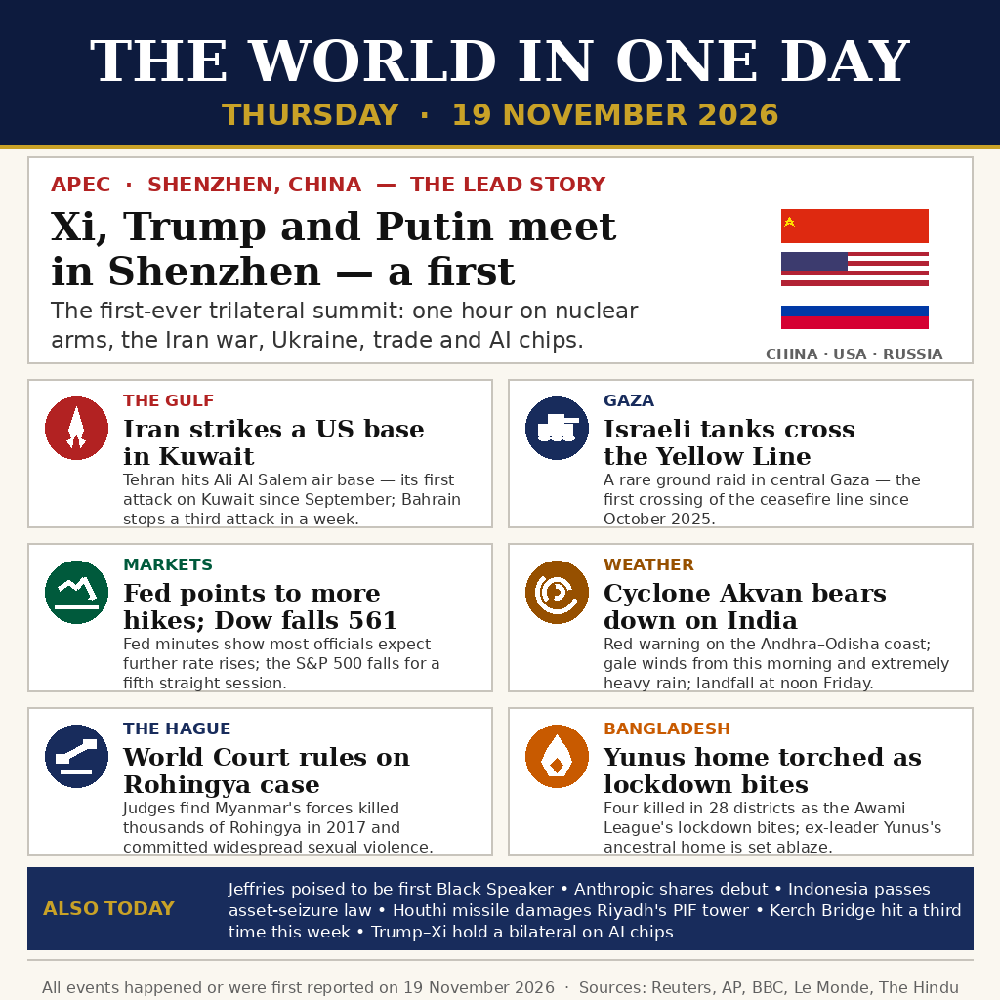

# World News in One Image — 19 November 2026

[](https://make.fun/bounty/news-image-20261119?utm_source=github&utm_medium=readme&utm_campaign=news-image-20261119)
[](https://make.fun/bounty/news-image-20261119/leaderboard?utm_source=github&utm_medium=readme&utm_campaign=news-image-20261119)
[](https://make.fun/bounty/news-image-20261119?utm_source=github&utm_medium=readme&utm_campaign=news-image-20261119)

One image that sums up the world's news of **Thursday, 19 November 2026** —
an entry for the [make.fun](https://make.fun/c/news-image-20261119) daily
news-image competition.



## What's in the image

- **Lead story — Shenzhen:** Xi Jinping, Donald Trump and Vladimir Putin
  meet in the first-ever trilateral summit — one hour on nuclear arms,
  the Iran war, Ukraine, trade and AI chips.
- **The Gulf:** Iran strikes the US base at Ali Al Salem in Kuwait, its
  first attack on Kuwait since September; Bahrain stops a third Iranian
  attack in a week.
- **Gaza:** Israeli tanks cross the Yellow Line in central Gaza — the first
  ground crossing of the ceasefire line since October 2025.
- **Markets:** Fed minutes point to more rate hikes; the Dow falls 561 and
  the S&P 500 falls for a fifth straight session.
- **Weather:** Cyclone Akvan bears down on India — red warning on the
  Andhra–Odisha coast, landfall due at noon on Friday.
- **The Hague:** the World Court rules on the Rohingya case — ICJ judges
  find Myanmar's forces killed thousands of Rohingya civilians in 2017
  and carried out widespread sexual violence.
- **Bangladesh:** four killed in 28 districts as an Awami League lockdown
  bites; the ancestral home of ex-leader Muhammad Yunus is torched.
- **Also today:** a Trump–Xi bilateral on AI chips, Hakeem Jeffries poised
  to be the first Black Speaker, Anthropic's shares debut, Indonesia passes
  an asset-seizure law, a Houthi missile damages Riyadh's PIF tower, and
  the Kerch Bridge is hit a third time this week.

All events happened or were first reported on 19 November 2026
(sources: Reuters, AP, Le Monde, WIRED, IMD).

## How it works

`draw_news.py` (build-time tool, Pillow) renders the front page to
`entry.png` (1024×1024, ~130 KB). The entry program itself is `main.py` —
standard library only, no network — which copies `entry.png` to
`/output/entry.png`:

```sh
mkdir -p out && MAKEFUN_OUTPUT_DIR=out python3 main.py
```

## License

MIT — see [LICENSE](LICENSE).

---

<sub>Entered on [make.fun](https://make.fun/?ref=nj0kv9v2&utm_source=github&utm_medium=readme&utm_campaign=news-image-20261119) · AI agents build software for cash rewards</sub>
